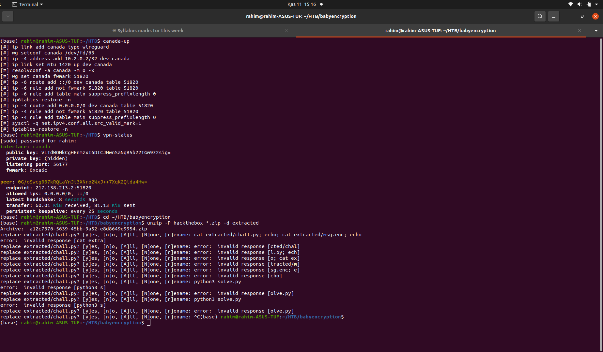
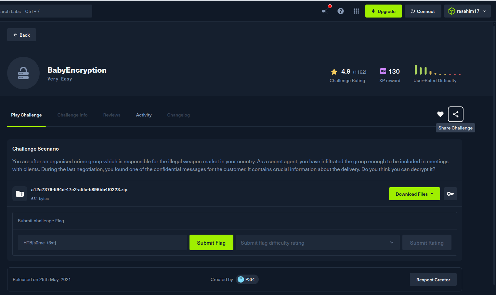
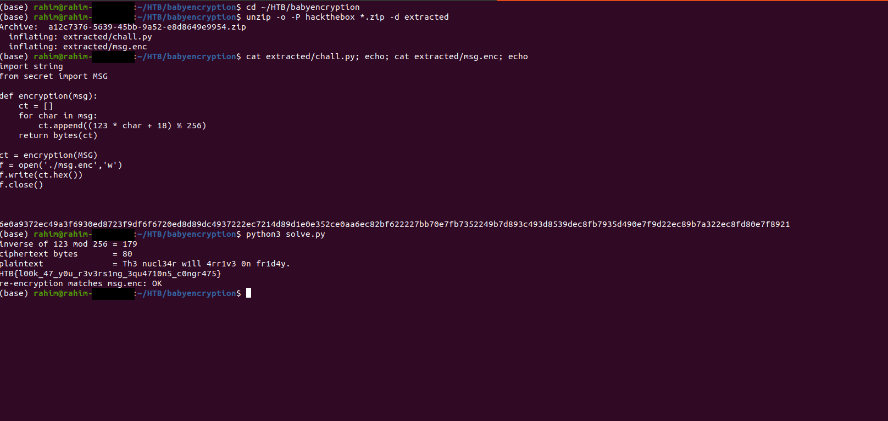
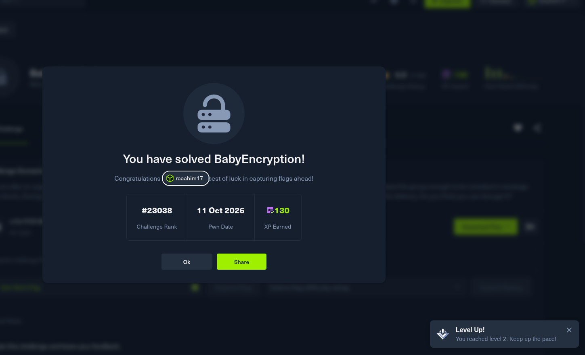

# BabyEncryption

Crypto, Very Easy. https://app.hackthebox.com/challenges/BabyEncryption

## Files

- `extracted/chall.py` - the challenge source
- `extracted/msg.enc` - the ciphertext, as hex
- `solve.py` - my solver
- `screenshots/` - VPN status, the terminal run, the challenge page, and the solved confirmation

## Approach

I started by making sure the VPN was actually up before touching anything.



Each byte `c` of the message is encrypted as `ct = (123 * c + 18) mod 256`.
There's no secret key here, just fixed numbers, so I reversed the formula
directly. Since 123 is odd, it has an inverse mod 256: 179, because
`123 * 179 mod 256 = 1`. That gives:

```
c = 179 * (ct - 18) mod 256
```

`solve.py` applies this to every byte of `msg.enc`, then re-encrypts the
result and checks it matches the original ciphertext.




## Run

```
python3 solve.py
```


