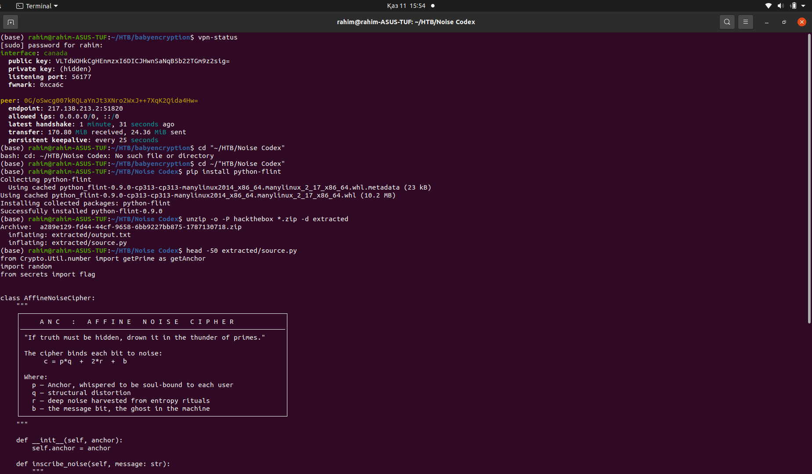
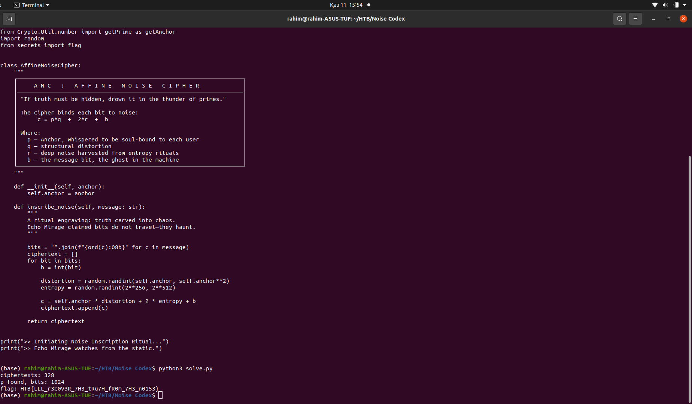
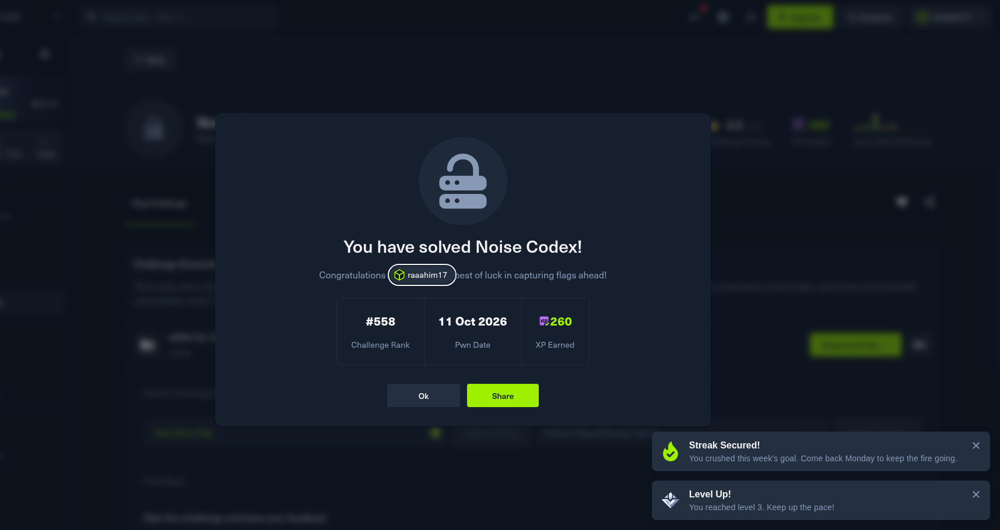

# Noise Codex

Crypto, Easy. https://app.hackthebox.com/challenges/NoiseCodex

## Files

- `extracted/source.py` - the challenge source
- `extracted/output.txt` - 328 ciphertext numbers (one per bit of the flag)
- `solve.py` - my solver (needs `python-flint` for LLL: `pip install python-flint`)
- `screenshots/` - setup, the terminal run, the challenge page, and the solved confirmation

## Approach


Each bit `b` of the flag is encrypted as `c = p*q + 2*r + b`, where `p` is one
1024-bit prime reused for every bit, `q` is random between `p` and `p^2`, and
`r` is random between `2^256` and `2^512`. The noise `2*r + b` stays under
`2^513`, far smaller than `p`, so `c mod p` recovers the noise, and its last
bit is the message bit.

This is the approximate GCD problem: every ciphertext is close to a multiple
of the same unknown `p`. I solved it with lattice reduction (LLL). I built a
lattice from 13 ciphertexts, and LLL found a short vector that revealed the
multiplier for the first ciphertext, which gives `p` directly.

Once `p` is known, `(c mod p) & 1` gives each bit, and grouping them by 8
recovers the flag.



## Run

```
pip install python-flint
python3 solve.py
```



