# Orion

Machine, Easy, Linux. https://app.hackthebox.com/machines/Orion

## Files

- `nmap_initial.txt` - initial `nmap -sCV` scan
- `gobuster_common.txt` - directory/file enumeration of the web app
- `hash.txt` - the bcrypt hash recovered from the app's database (cracked with hashcat and rockyou)
- `screenshots/` - the whole run, from VPN connect to both flags submitted

## Approach

### 1. Recon

`nmap -sCV` found SSH (22) and HTTP (80, nginx). The HTTP service redirects
to the vhost `orion.htb`, so I added it to `/etc/hosts`.

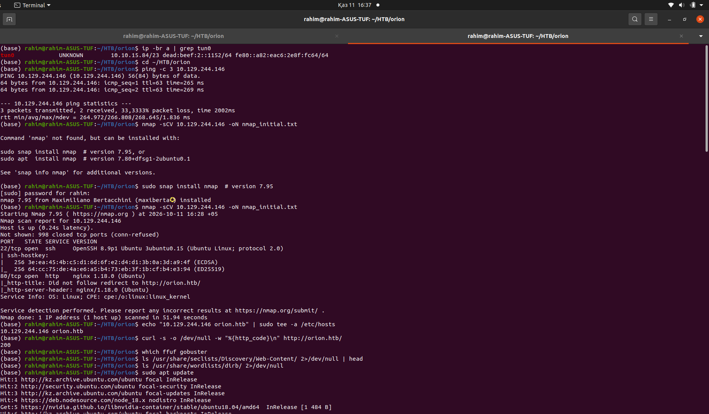

### 2. Web enumeration

The site is a telecom company landing page. I ran `gobuster` against
`common.txt` and found `/admin`, which redirects to `/admin/login`, a Craft
CMS 5.6.16 login page (the response headers also show `X-Powered-By:
Craft CMS`).

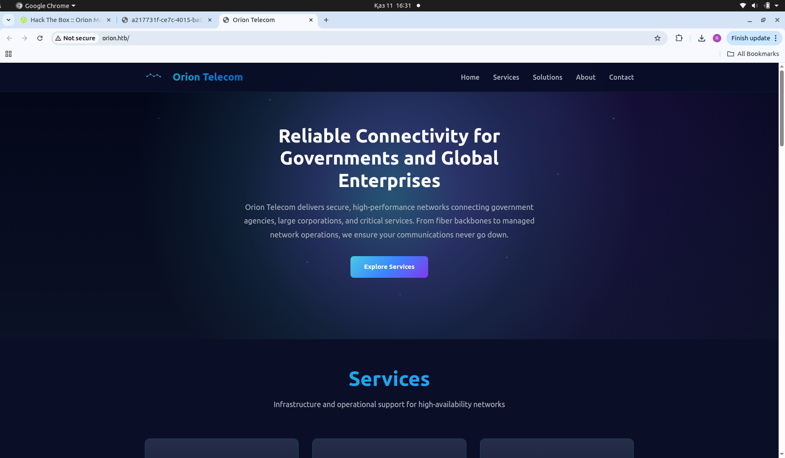
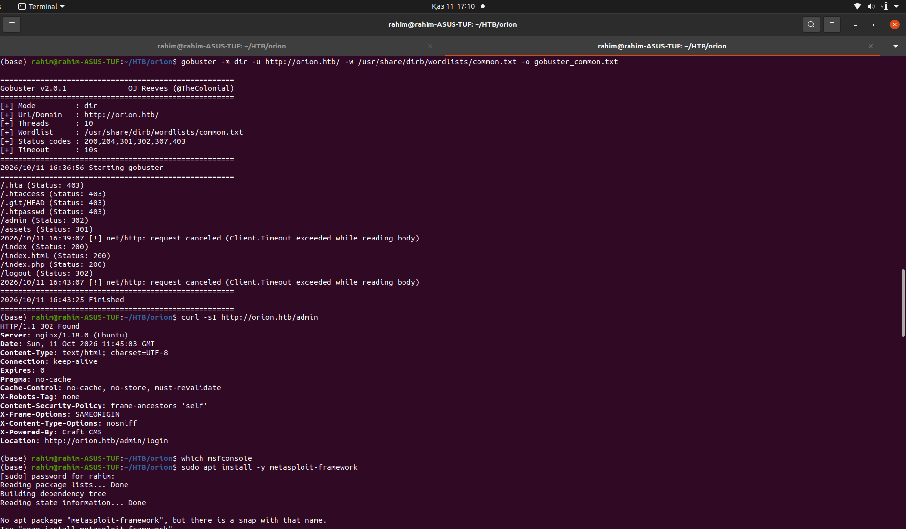
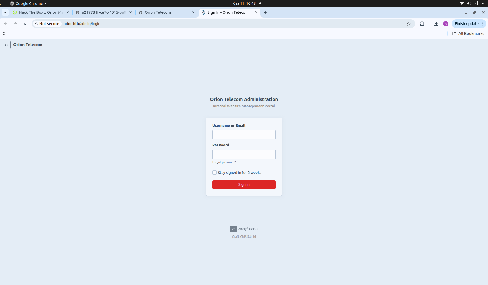

### 3. Foothold - CVE-2025-32432

Craft CMS versions up to 5.6.16 are vulnerable to an unauthenticated remote
code execution bug in the `actions/assets/generate-transform` endpoint. The
root cause is a Yii framework object-injection issue: a `__class` key in the
request body gets deserialized unsafely. CVSS 10.0, critical.

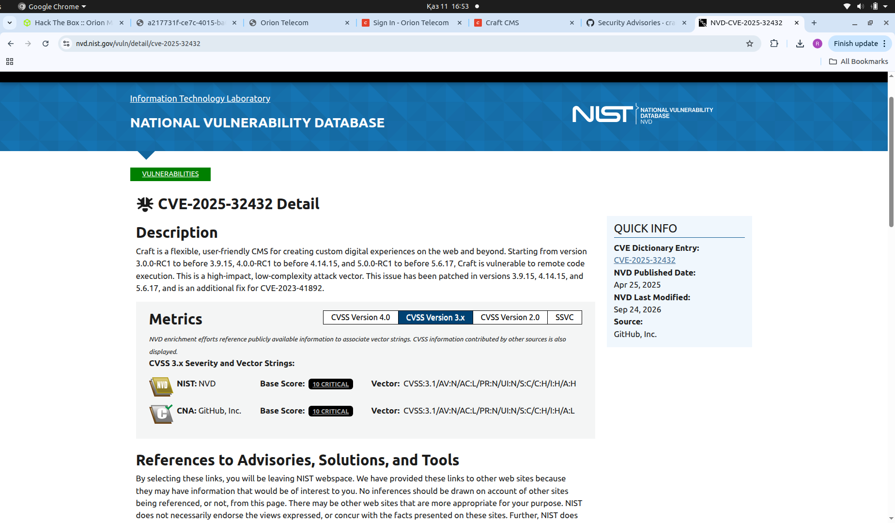
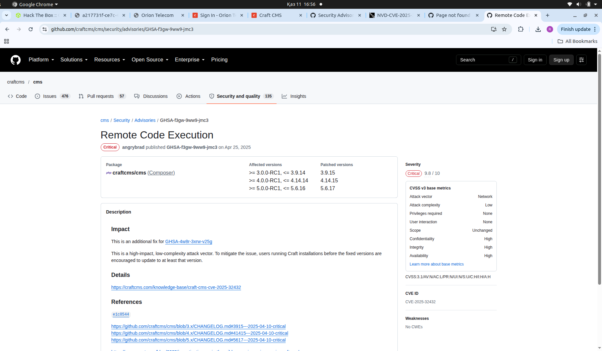

I used the Metasploit module
`exploit/linux/http/craftcms_preauth_rce_cve_2025_32432`, which gave me a
shell as `www-data`.

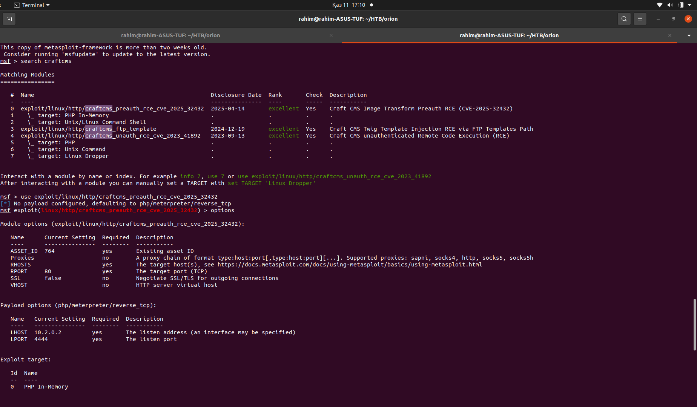
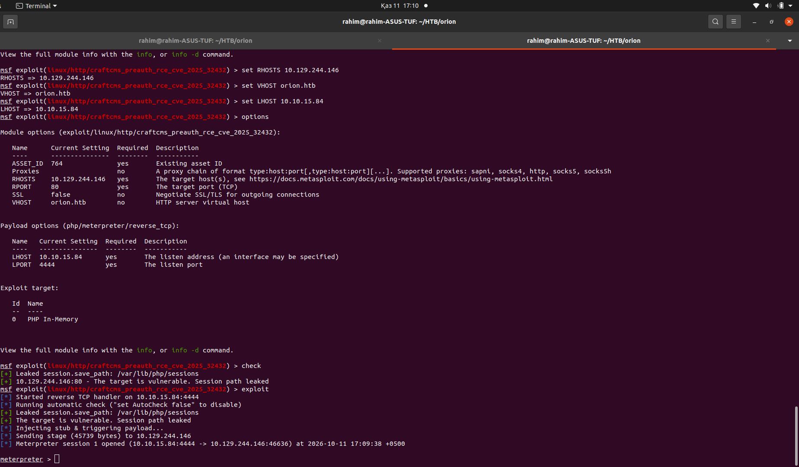

### 4. Credential exposure

`/var/www/html/craft/.env` had the MySQL root password sitting in plaintext.
Logging into MySQL and reading the `users` table gave me a bcrypt password
hash for the admin account (email `adam@orion.htb`).

### 5. Cracking and credential reuse

`hashcat -m 3200` against the hash with the rockyou wordlist cracked it to
`darkangel` in seconds, GPU-accelerated. That same password turned out to
also be `adam`'s SSH login, so reused credentials gave me direct SSH access
and the user flag.

### 6. Privilege escalation - CVE-2026-24061

Once I had a shell as `adam`, `ss -tln` showed a `telnetd` (GNU inetutils
2.7) listening on `127.0.0.1:23` only, local to the box. This version allows
a remote authentication bypass: the client-supplied `USER` telnet
environment variable gets passed straight into `/bin/login` without
sanitizing it, so setting `USER="-f root"` is read as a flag to `login`
meaning "already authenticated," skipping the password check entirely:

```
USER="-f root" telnet -a 127.0.0.1
```

That dropped me straight into a root shell.

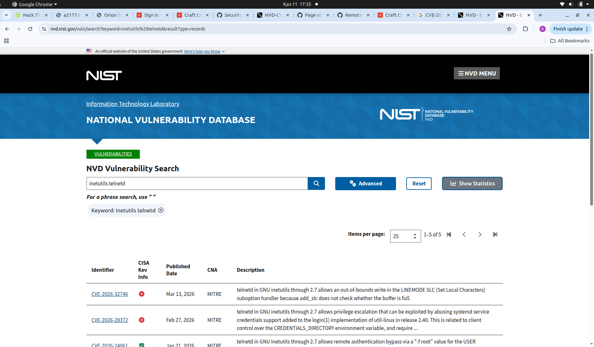
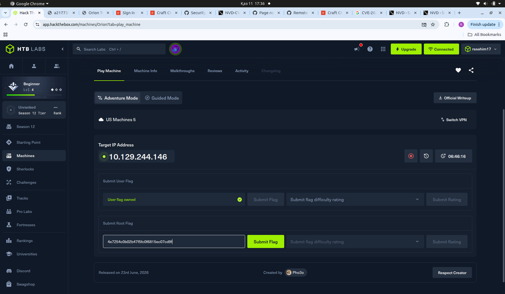
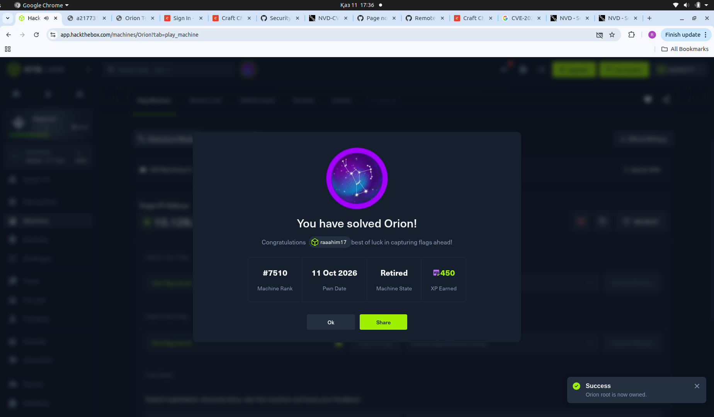

## Key CVEs

- [CVE-2025-32432](https://github.com/craftcms/cms/security/advisories/GHSA-f3gw-9ww9-jmc3) - Craft CMS pre-auth RCE, CVSS 10.0
- [CVE-2026-24061](https://nvd.nist.gov/vuln/detail/CVE-2026-24061) - GNU inetutils telnetd auth bypass via the USER environment variable
